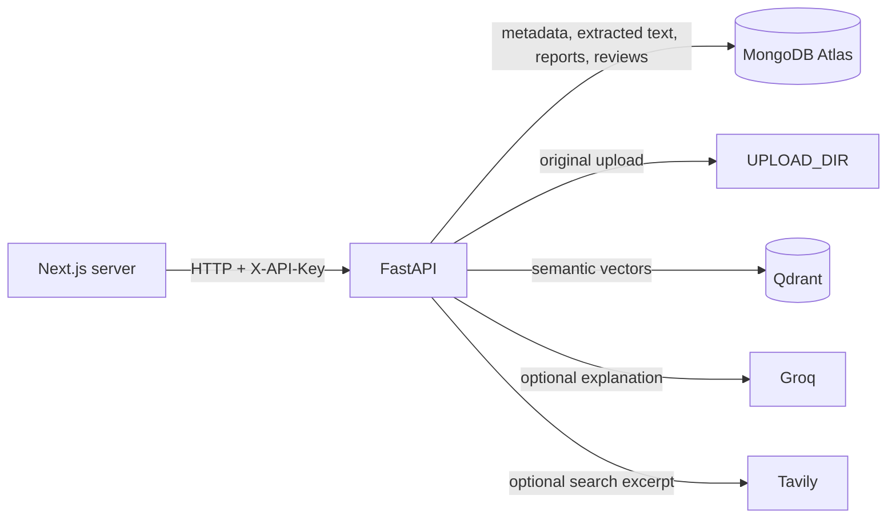

# Backend API reference

FastAPI owns authentication, file processing, analysis, persistence, and all
provider credentials. The Next.js server should call this API; browser code must
not connect directly to MongoDB Atlas or Qdrant.

## Connect from the frontend

Run the backend from `backend/`:

```bash
.venv/bin/uvicorn main:app --host 127.0.0.1 --port 8000
```

Set `BACKEND_API_URL` and `BACKEND_API_KEY` in the Next.js server environment.
Use server-side code (a Route Handler or Server Action) to call the backend and
forward the API key. Do not expose `BACKEND_API_KEY` with a `NEXT_PUBLIC_` name.

```ts
const response = await fetch(`${process.env.BACKEND_API_URL}/api/v1/submissions`, {
  method: "POST",
  headers: { "X-API-Key": process.env.BACKEND_API_KEY! },
  body: formData, // FormData with a `file` field; do not set Content-Type manually
  cache: "no-store",
});

if (!response.ok) throw new Error(`Backend returned ${response.status}`);
const report = await response.json();
```

Local base URL: `http://127.0.0.1:8000`. Every route below, except
`GET /healthz`, requires `X-API-Key: <API_KEY>`.

## Data flow and storage



MongoDB collections:

- `submissions`: `id`, `filename`, `content_type`, `language`, `extracted_text`,
  `file_path`, optional `embedding`/`embedding_model`, and `created_at`.
- `results`: `id`, `submission_id`, `source_id`, `source_type`, `method`, `score`,
  `evidence`, `review_status`, `review_note`, optional `explanation` and
  `explanation_model`, and `created_at`.

Qdrant stores vectors and small lookup payloads, not the canonical report or
review record. Original file bytes remain in `UPLOAD_DIR`; use persistent object
storage such as S3 before running replaceable or multiple AWS containers.

## Routes

### Health and readiness

#### `GET /healthz`

No authentication. Liveness only; it does not check the databases.

```json
{"status":"ok","service":"terabox-analysis"}
```

#### `GET /readyz`

Requires API key. Checks MongoDB and the configured Qdrant connection.

```json
{"status":"ready","database":"ok","vector_store":"qdrant"}
```

Returns `503` when a configured persistence service is unavailable.

### Submissions

#### `POST /api/v1/submissions`

Requires API key. `multipart/form-data`, field name `file`. Supported files:
TXT, Markdown, PDF, DOCX, and the code extensions listed in `documents.py`.
The configured upload-size and extracted-text limits apply.

Response `200`:

```json
{
  "submission": {
    "id":"<uuid>", "filename":"assignment.txt", "content_type":"document",
    "language":null, "created_at":"<ISO-8601>", "text_length":1200
  },
  "results":[
    {
      "id":"<uuid>", "submission_id":"<uuid>", "source_id":"<uuid>",
      "source_type":"internal", "method":"tfidf_cosine", "score":0.82,
      "evidence":{"method":"tfidf_cosine","score":0.82,"matched_passages":[]},
      "review_status":"pending", "review_note":null,
      "explanation":null, "explanation_model":null, "created_at":"<ISO-8601>"
    }
  ]
}
```

`results` is empty if there are no comparable submissions yet. Scores are
similarity signals and require human review; they are not a finding of
plagiarism. Errors include `401` unauthenticated, `413` oversized, `415`
unsupported file type, and `422` invalid or unreadable content. If optional
semantic embedding is unavailable, upload and lexical/code comparison continue;
the backend logs the provider failure and omits semantic scores and vectors.

#### `GET /api/v1/submissions?content_type=document|code`

Requires API key. `content_type` is optional.

```json
{"items":[{"id":"<uuid>","filename":"assignment.txt","content_type":"document","language":null,"created_at":"<ISO-8601>"}]}
```

#### `GET /api/v1/submissions/{submission_id}`

Requires API key. Returns public submission metadata and `text_length`; `404`
when absent.

#### `DELETE /api/v1/submissions/{submission_id}`

Requires API key. Removes the MongoDB submission, associated result rows, and
stored original file.

```json
{"deleted":"<uuid>"}
```

### Analysis and reports

#### `POST /api/v1/analyses/{submission_id}`

Requires API key. Re-runs internal document or same-language code comparisons.

```json
{"submission_id":"<uuid>","results":[{"id":"<uuid>","method":"tfidf_cosine","score":0.82,"evidence":{"matched_passages":[]}}]}
```

#### `GET /api/v1/results?submission_id=<uuid>`

Requires API key. The filter is optional. Returns `{"items":[<result>, ...]}`;
result objects include score, method, source, evidence, reviewer status, and any
saved explanation.

#### `GET /api/v1/results/{result_id}`

Requires API key. Returns one result with evidence; `404` when absent.

#### `PATCH /api/v1/results/{result_id}/review`

Requires API key. Set a reviewer-controlled status and optional note:

```json
{"status":"reviewed","note":"Checked the matched excerpts."}
```

Allowed statuses: `pending`, `reviewed`, `relevant`, `dismissed`. Returns the
updated result; `422` for an invalid status and `404` when absent.

### Optional AI and web integrations

#### `POST /api/v1/results/{result_id}/explanation`

Requires API key; no request body. Requires `ALLOW_EXTERNAL_AI=true` and a
`GROQ_API_KEY`. Sends that result's evidence to Groq and saves the response in
MongoDB.

```json
{"result_id":"<uuid>","model":"<model>","generated":true,"text":"<evidence-grounded explanation>"}
```

#### `POST /api/v1/analyses/{submission_id}/web-search`

Requires API key; no request body. Requires `ALLOW_EXTERNAL_SEARCH=true`,
`WEB_SEARCH_PROVIDER=tavily`, and `TAVILY_API_KEY`. Sends up to 400 characters
from the submission to Tavily; saves candidate URLs, excerpts, and comparisons.
Returns `{"submission_id":"<uuid>","results":[...]}`.

#### `POST /api/v1/agent/run`

Requires API key. Requires `AGENT_ENABLED=true`, `ALLOW_EXTERNAL_AI=true`, and
`GROQ_API_KEY`.

```json
{"submission_id":"<uuid>","message":"Compare this with prior submissions and summarize the evidence."}
```

Response:

```json
{
  "submission_id":"<uuid>", "model":"groq:openai/gpt-oss-120b",
  "report":{
    "summary":"<summary>", "evidence_ids":["<result-id>"],
    "suggested_next_steps":["Review the matched passage."],
    "human_review_required":true
  },
  "tools_invoked":["inspect_submission","run_similarity_analysis"],
  "usage":{"requests":2,"tool_calls":1}
}
```

The agent can read submission metadata, run comparison, retrieve Qdrant matches,
and search public sources when explicitly asked. It cannot change review status
or decide misconduct.

### Vector search

#### `POST /api/v1/vectors/search`

Requires API key and `ENABLE_SEMANTIC=true`. The configured Hugging Face model
is downloaded and run locally; `HF_TOKEN` is optional for Hub downloads. This
route does not use Hugging Face Inference Provider credits.

```json
{"text":"short query text","limit":10}
```

`limit` defaults to 10 and must be 1–100. Response:

```json
{"model":"<embedding-model>","items":[{"vector_id":"<submission-id>","payload":{"filename":"assignment.txt"},"score":0.91}]}
```

Returns `503` if embeddings are disabled or `502` if the provider/search fails.

## AWS deployment configuration

Set `MONGODB_URI` and `MONGODB_DATABASE` on the FastAPI service using AWS
Secrets Manager or another secret manager; never put the URI in Next.js or a
browser bundle. Use an Atlas network rule/private endpoint appropriate to the
AWS VPC. Also provide Qdrant settings and persistent S3 storage for original
uploads. `/readyz` should pass before routing frontend traffic.
